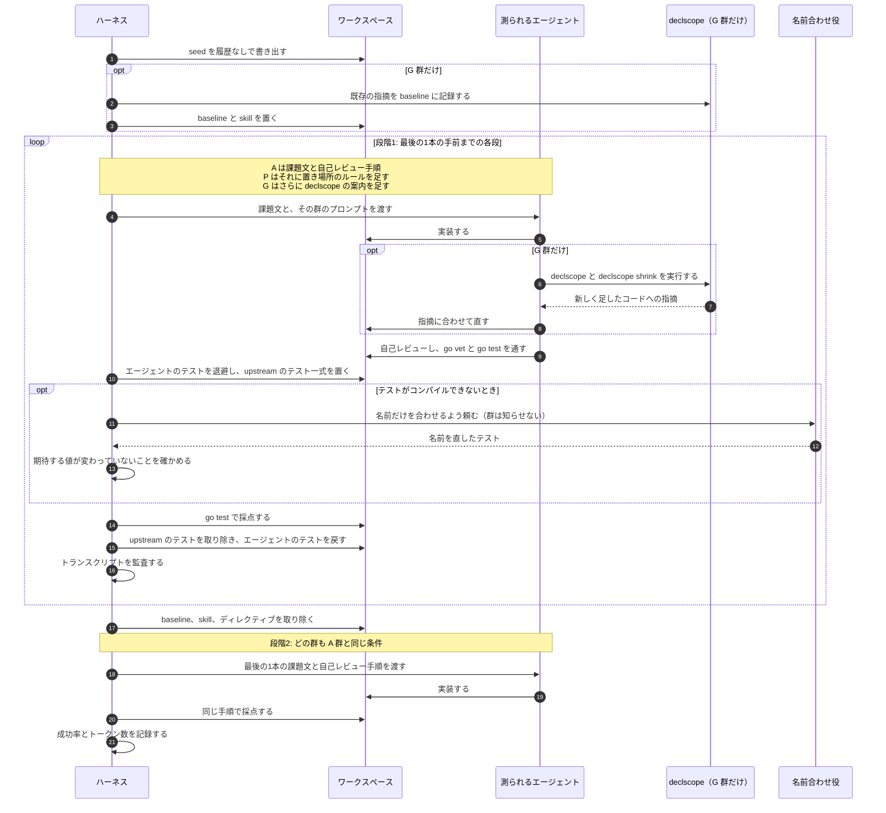

# declscope in practice

[declscope](https://github.com/mpyw/declscope) は、AI エージェントが変更しやすい新しいコードを書く助けになるか？

> [!NOTE]
> 実験は進行中で、まだ結果はない。

オープンソースの Go プロジェクトで実際にマージされた PR を、エージェントに3通りの条件で実装させる。ルールを渡さない、ルールをプロンプトで渡す、ルールをプロンプトで渡したうえで declscope に検査させる、の3通り。続いて、別のエージェントが、それぞれの結果に実際の次の変更を加える。このエージェントは declscope を使わない。あわせて、ブラインドのレビュアーが、結果のコードにまだ必要なリファクタリングを探す。

詳細は [design.md](design.md) にある。進み具合は [Epic #12](https://github.com/mpyw-yattemita/declscope-in-practice/issues/12) で追う。

## 3つの群

| | A: なし | P: プロンプト | G: ガードレール |
| --- | --- | --- | --- |
| 課題文 | あり | あり | あり |
| 自己レビュー手順 | あり | あり | あり |
| 置き場所のルール（[rule.md](harness/prompts/rule.md)） | なし | あり | あり |
| declscope 本体と baseline | なし | なし | あり |
| `declscope-authoring` skill | なし | なし | あり |
| 終える前のチェック | `go vet`、`go test` | `go vet`、`go test` | `go vet`、`go test`、`declscope`、`declscope shrink` |

P と G の違いは、ルールを機械が検査するかどうかだけ。

## 実験の流れ

1つの課題は、同じ package に続けてマージされた 3〜5本の PR（連続）。最後の1本の手前までを各群の条件で実装し、最後の1本は、どの群も A 群と同じ条件で実装する。最後の1本にかかった手間で、それまでに作られたコードの変更しやすさを測る。

段階2の結果を、[判定ルール](design.md#判定ルール) で群ごとに比べる。成功率が下がっておらず、トークン数が少ない群の勝ち。
